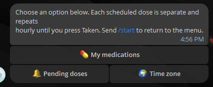
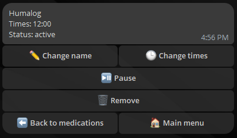

# Telegram pill reminders

A multi-user Telegram bot for daily medication reminders. Each user manages
their own medications in a private chat, with times interpreted in their chosen
IANA time zone.

The bot is already running at [@tablet_reminderbot](https://t.me/tablet_reminderbot).
Open a private chat and send `/start` to get started.

**This is a convenience reminder, not a medical monitoring or emergency
service.** Delivery depends on the bot, network, Telegram, and your device.

## Features

- Add, rename, pause, enable, or remove medications with buttons.
- Add or remove individual daily times without re-entering the others.
- Receive separate reminders for each scheduled dose, repeated hourly until
  **Taken** is pressed. The selected notification then shows the taken time
  and its button is removed.
- View pending doses, including paused ones. Previously sent notifications for
  a taken dose may still have buttons; they report that the dose is no longer
  pending.
- Recover missed doses after downtime. Pending doses survive restarts.
- Set a time zone per user, with daylight-saving handling.
- Optionally view private, admin-only usage counts for the last 90 days.

| Main menu | Medications | Medication settings |
|---|---|---|
|  |  |  |

## Requirements

- Python 3.9 or newer, with `venv` support.
- A Telegram bot token from [BotFather](https://t.me/BotFather).
- Persistent storage for the SQLite database and a continuously running process.

## Quick start

```sh
git clone https://github.com/GreyWolfDev/medreminderbot.git
cd medreminderbot
python3 -m venv .venv
.venv/bin/python -m pip install -r requirements-pill.txt
export BOT_TOKEN='your-token-from-botfather'
.venv/bin/python pill_reminder.py
```

In a private chat with the bot, send `/start` and enter an IANA time zone, such
as `Europe/London` or `America/New_York`. The bot cannot determine it
automatically. Use **My medications** to add and manage reminders. Anyone who
can contact the bot can create their own reminders; group chats are not
supported.

Run only one instance per bot and database. By default, the database is
`pill_reminders.sqlite3` in the working directory. It contains sensitive
medication names, schedules, pending doses, and user information: restrict
access and back it up securely. Do not commit the database, environment files,
or bot token.

## Configuration

| Variable | Required | Meaning |
|---|---|---|
| `BOT_TOKEN` | Yes | Telegram token from BotFather. |
| `PILL_DB` | No | SQLite database path; defaults to `pill_reminders.sqlite3`. Its parent directory must exist and be writable. |
| `PILL_ADMIN_ID` | No | Numeric Telegram user ID permitted to use `/stats` in a private chat. Send `/id` to obtain your ID. |
| `PILL_LOG_TIMING` | No | Set to `1` to log Telegram API and update-processing timings. |

The bot logs user identities and activity, but not medication names or dose
times. Activity events are retained in the database for approximately 90 days;
system logs and backups have separate retention. Protect the database, logs,
and administrator's Telegram account. The bot does not retain a
medication-specific history of taken doses.

## Debian systemd service

Install the application and its virtual environment in `/opt/pill-reminder`,
for example:

```sh
sudo git clone https://github.com/GreyWolfDev/medreminderbot.git /opt/pill-reminder
sudo python3 -m venv /opt/pill-reminder/.venv
sudo /opt/pill-reminder/.venv/bin/python -m pip install -r /opt/pill-reminder/requirements-pill.txt
```

Create `/etc/pill-reminder.env`, owned by root with mode `0600`, containing:

```text
BOT_TOKEN=your-token-from-botfather
PILL_DB=/var/lib/pill-reminder/pill_reminders.sqlite3
# Optional:
# PILL_ADMIN_ID=your-numeric-telegram-user-id
```

Create `/etc/systemd/system/pill-reminder.service`:

```ini
[Unit]
Description=Telegram pill reminders
After=network-online.target
Wants=network-online.target

[Service]
Type=simple
DynamicUser=yes
StateDirectory=pill-reminder
WorkingDirectory=/opt/pill-reminder
EnvironmentFile=/etc/pill-reminder.env
ExecStart=/opt/pill-reminder/.venv/bin/python /opt/pill-reminder/pill_reminder.py
Restart=on-failure
RestartSec=10

[Install]
WantedBy=multi-user.target
```

Ensure the service user can read the application and virtual environment and
write the state directory and database. If moving an existing database, stop
the old bot, back it up first, and verify both file and directory permissions;
do not make it world-writable. Then run:

```sh
sudo systemctl daemon-reload
sudo systemctl enable --now pill-reminder
sudo systemctl status pill-reminder
sudo journalctl -u pill-reminder -n 50 --no-pager
```

Restart the service after updating the source or environment file. If the
unit file changes, run `sudo systemctl daemon-reload` before restarting. The
environment file is loaded by systemd, not by direct Python invocation.

## Scheduling details

Each scheduled time creates a separate dose. A successful notification repeats
one hour after its previous delivery until that dose is marked taken. If
delivery fails, it is logged and retried. If editing a notification fails after
**Taken**, the dose remains marked taken and the failure is logged.

Pausing stops pending alerts and prevents new doses; enabling resumes pending
alerts and future schedules without backfilling the paused period. Changing a
schedule preserves existing pending doses and the next-due values of unchanged
times. Newly added times start going forward.

Time-zone changes keep daily clock times unchanged and leave pending doses
pending. During a spring daylight-saving gap, a nonexistent time moves to the
first valid minute; during an autumn overlap, the first occurrence is used.

## Tests and source layout

```sh
.venv/bin/python -m unittest -v test_pill_reminder
```

`pill_reminder.py` is the entry point. The `pill_bot` package separates the
update loop, scheduling and storage, Telegram communication, menus, activity
reporting, and shared helpers. Keep the package alongside the entry point.
