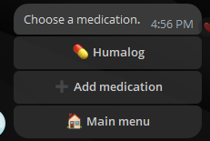

# Telegram pill reminders

A multi-user Telegram bot for daily medication reminders. Each user manages
their own medications in a private chat, with times interpreted in their chosen
IANA time zone.

The bot is already running at [@tablet_reminderbot](https://t.me/tablet_reminderbot).
Open a private chat and send `/start` to get started.

**This is a convenience reminder, not a medical monitoring or emergency
service.** Delivery depends on the bot, network, Telegram, and your device.

## Features

- Add, rename, pause, enable, or remove medications with buttons.
- Add or remove individual daily times without re-entering the others.
- Receive separate reminders for each scheduled dose, repeated hourly until
  **Taken** is pressed. The selected notification then shows the taken time
  and its button is removed.
- View pending doses, including paused ones. Previously sent notifications for
  a taken dose may still have buttons; they report that the dose is no longer
  pending.
- Recover missed doses after downtime. Pending doses survive restarts.
- Set a time zone per user, with daylight-saving handling.
- Encrypt medication names and unfinished conversation data in the database.
- Use **Stats** on the main menu or `/stats` in a private chat to see your own
  activity counts for the last 90 days. The configured admin sees aggregate
  counts and the number of distinct users with recorded activity in that period.
  Reports contain no user names, IDs, or medication names.
- Use **Delete my data** on the main menu or `/forget` to delete everything the
  bot stores about you, after a confirmation. Messaging the bot again
  afterwards stores your details again as for a new user.

| Main menu | Medications | Medication settings |
|---|---|---|
|  |  |  |

## Requirements

- Python 3.9 or newer, with `venv` support.
- A Telegram bot token from [BotFather](https://t.me/BotFather).
- Persistent storage for the SQLite database and a continuously running process.

## Quick start

```sh
git clone https://github.com/GreyWolfDev/medreminderbot.git
cd medreminderbot
python3 -m venv .venv
.venv/bin/python -m pip install -r requirements-pill.txt
export BOT_TOKEN='your-token-from-botfather'
export PILL_ENCRYPTION_KEY="$(.venv/bin/python -c 'from cryptography.fernet import Fernet; print(Fernet.generate_key().decode())')"
.venv/bin/python pill_reminder.py
```

The command above generates a **new** key. Save it securely outside the database
and reuse it on every restart; do not generate a replacement for an existing
encrypted database. Losing the key makes encrypted data unrecoverable.

In a private chat with the bot, send `/start` and enter an IANA time zone, such
as `Europe/London` or `America/New_York`. The bot cannot determine it
automatically. Use **My medications** to add and manage reminders. Anyone who
can contact the bot can create their own reminders; group chats are not
supported.

Run only one instance per bot and database. By default, the database is
`pill_reminders.sqlite3` in the working directory. It contains sensitive
information even with encryption enabled: restrict access and back it up
securely. Do not commit the database, environment files, key, or bot token.

## Configuration

| Variable | Required | Meaning |
|---|---|---|
| `BOT_TOKEN` | Yes | Telegram token from BotFather. |
| `PILL_ENCRYPTION_KEY` | Yes | Persistent Fernet key, stored separately from the database. |
| `PILL_DB` | No | SQLite database path; defaults to `pill_reminders.sqlite3`. Its parent directory must exist and be writable. |
| `PILL_ADMIN_ID` | No | Numeric Telegram user ID that receives aggregate `/stats` instead of personal counts. Send `/id` to obtain your ID. |
| `PILL_LOG_TIMING` | No | Set to `1` to log Telegram API and update-processing timings. |

The bot logs user identities and activity, but not medication names or dose
times. Activity events are linked to Telegram user IDs in the database to
produce personal reports, and are retained for approximately 90 days. The
stored username or first name of a user with no medications and no activity in
the last 90 days is also deleted; both checks run at startup and then daily.
System logs and backups have separate retention. Protect the database, logs,
and administrator's Telegram account. The bot does not retain a
medication-specific history of taken doses.

## Deleting your data

`/forget`, or **Delete my data** on the main menu, asks for confirmation and
then deletes, in one transaction, all of that user's medications, schedules,
pending doses, unfinished conversation, time zone, stored name and activity
events. Only the newest confirmation button works, and only for 5 minutes.
Cancelling, sending any other command, or pressing another button such as
**Taken** withdraws the request. Typing plain text while it is open shows the
confirmation again with a new button, and the earlier button stops working.
An older, expired or withdrawn confirmation does nothing. The bot enables SQLite's `secure_delete`, so
deleted content is overwritten in the database file. Copies can remain in
backups, snapshots, system logs, SQLite journal or WAL remnants, storage
remnants, and the Telegram chat itself, which the bot does not delete.

## Privacy and encryption

The bot encrypts medication names and unfinished conversation data using
authenticated Fernet encryption before storing them in SQLite. The key is
provided separately through `PILL_ENCRYPTION_KEY`. A missing, invalid, or
incorrect key prevents startup rather than silently losing data.

This protects a database file inspected without the key. It does **not** prevent
a server administrator who can read the key, inspect the running bot, or
modify its code from accessing names. Telegram messages contain names, and
schedules, pending-dose metadata, user identities, and activity events are not
encrypted. Old backups, snapshots, and storage remnants may also contain
plaintext names. Protect the key, database, backups, logs, and Telegram accounts.

## Debian systemd service

Install the application and its virtual environment in `/opt/pill-reminder`,
for example:

```sh
sudo git clone https://github.com/GreyWolfDev/medreminderbot.git /opt/pill-reminder
sudo python3 -m venv /opt/pill-reminder/.venv
sudo /opt/pill-reminder/.venv/bin/python -m pip install -r /opt/pill-reminder/requirements-pill.txt
```

Create `/etc/pill-reminder.env`, owned by root with mode `0600`, containing:

```text
BOT_TOKEN=your-token-from-botfather
PILL_DB=/var/lib/pill-reminder/pill_reminders.sqlite3
PILL_ENCRYPTION_KEY=your-persistent-fernet-key
# Optional:
# PILL_ADMIN_ID=your-numeric-telegram-user-id
```

Generate a key once with the following command and place it in the root-only
environment file; don't share it or store its backup alongside the database:

```sh
/opt/pill-reminder/.venv/bin/python -c 'from cryptography.fernet import Fernet; print(Fernet.generate_key().decode())'
```

Keep a secure separate backup of the key. The database and its backups cannot
be decrypted without it.

Create `/etc/systemd/system/pill-reminder.service`:

```ini
[Unit]
Description=Telegram pill reminders
After=network-online.target
Wants=network-online.target

[Service]
Type=simple
DynamicUser=yes
StateDirectory=pill-reminder
WorkingDirectory=/opt/pill-reminder
EnvironmentFile=/etc/pill-reminder.env
ExecStart=/opt/pill-reminder/.venv/bin/python /opt/pill-reminder/pill_reminder.py
Restart=on-failure
RestartSec=10

[Install]
WantedBy=multi-user.target
```

Ensure the service user can read the application and virtual environment and
write the state directory and database. If moving an existing database, stop
the old bot, back it up first, and verify both file and directory permissions;
do not make it world-writable. Then run:

```sh
sudo systemctl daemon-reload
sudo systemctl enable --now pill-reminder
sudo systemctl status pill-reminder
sudo journalctl -u pill-reminder -n 50 --no-pager
```

Restart the service after updating the source or environment file. If the
unit file changes, run `sudo systemctl daemon-reload` before restarting. The
environment file is loaded by systemd, not by direct Python invocation.

### Upgrading an existing database

Stop the service and securely back up the database before upgrading. Make the
backup while the bot is stopped, or use SQLite's backup API so committed data
in any WAL is included. Pre-upgrade backups contain plaintext names.

Install the updated requirements, generate a key once, and add it as
`PILL_ENCRYPTION_KEY` to the protected environment file without removing the
existing settings. Start the service and check its status and logs. On startup,
the bot encrypts existing names and unfinished conversations transactionally,
then vacuums the database and truncates its SQLite WAL before processing
reminders. Interrupted cleanup is retried at startup; allow enough free disk
space for SQLite's vacuum operation.

Migration does not remove plaintext from old backups, snapshots, Telegram
messages, or filesystem remnants. Older bot versions cannot read the encrypted
database: to roll back, restore a protected pre-migration backup.

## Scheduling details

Each scheduled time creates a separate dose. A successful notification repeats
one hour after its previous delivery until that dose is marked taken. If
delivery fails, it is logged and retried. If editing a notification fails after
**Taken**, the dose remains marked taken and the failure is logged.

Pausing stops pending alerts and prevents new doses; enabling resumes pending
alerts and future schedules without backfilling the paused period. Changing a
schedule preserves existing pending doses and the next-due values of unchanged
times. Newly added times start going forward.

Time-zone changes keep daily clock times unchanged and leave pending doses
pending. During a spring daylight-saving gap, a nonexistent time moves to the
first valid minute; during an autumn overlap, the first occurrence is used.

## Tests and source layout

```sh
.venv/bin/python -m unittest -v test_pill_reminder
```

`pill_reminder.py` is the entry point. The `pill_bot` package separates the
update loop, scheduling and storage, Telegram communication, menus, activity
reporting, and shared helpers. Keep the package alongside the entry point.
